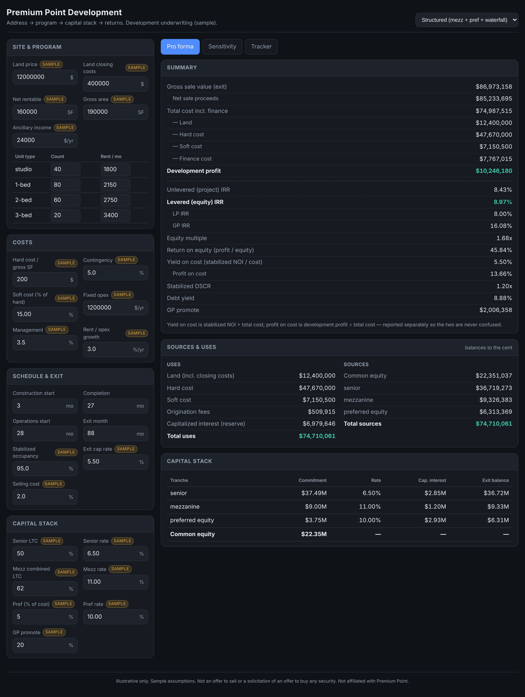
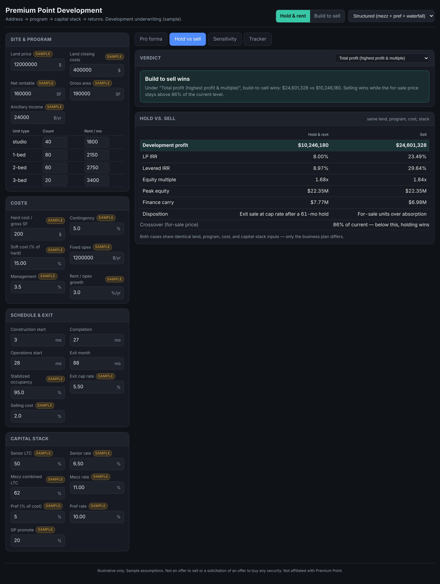
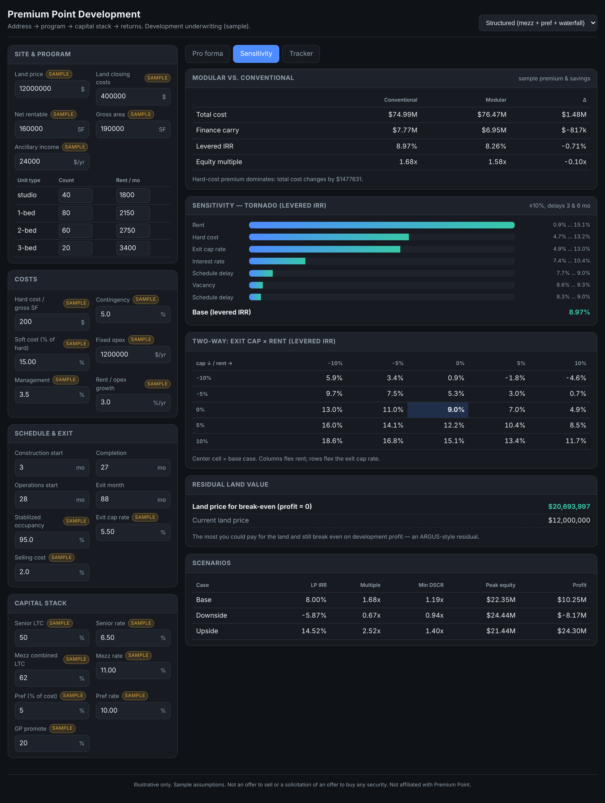
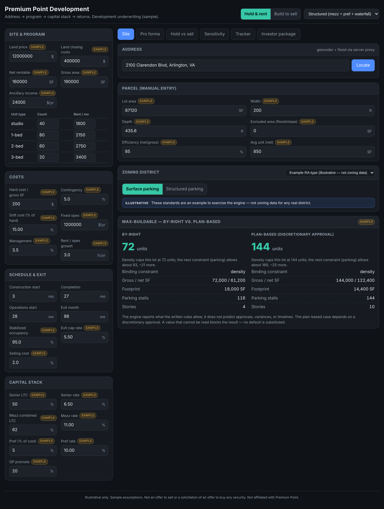
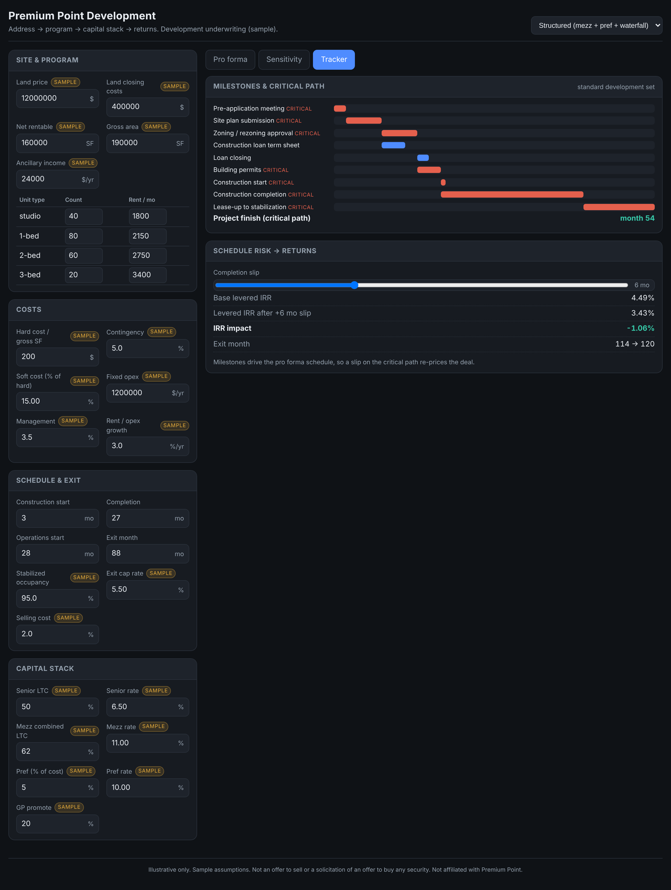
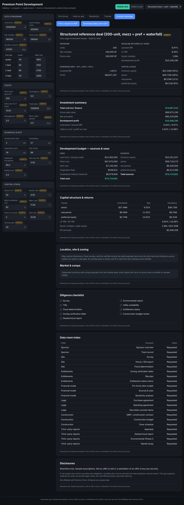

# Premium Point Development App

**Address → maximum-yield building program → full capital stack and returns →
investor-ready one-pager**, in one live page that recalculates as you type.

A portfolio piece demonstrating development-underwriting capability: financial
modeling, market/zoning analysis, and project management on large multifamily and
mixed-use deals — built on an original, tested calculation engine.

> **Not affiliated with Premium Point Development.** This is a portfolio piece. It
> uses no Premium Point logos or branding, and **every sample number carries a visible
> "sample" label.** Nothing here is market evidence.
>
> **Not legal or investment advice.** A real capital raise carries securities-law
> obligations. This app organizes materials; it does not provide legal review. Any real
> offering needs a securities attorney. Disclosure used throughout the investor package:
> *"Illustrative only. Sample assumptions. Not an offer to sell or a solicitation of an
> offer to buy any security."*

## Screenshots

| Pro forma (live appraisal report) | Hold vs. sell (verdict + crossover) |
| --- | --- |
|  |  |

| Sensitivity (tornado · two-way · RLV) | Site & max-buildable |
| --- | --- |
|  |  |

| Project tracker (critical path) | Investor package |
| --- | --- |
|  |  |

A **three-minute demo script** is in [`docs/demo-script.md`](docs/demo-script.md).

## Quickstart

Requires Node 20+.

```bash
npm install
```

```bash
npm run dev
```

```bash
npm test
```

```bash
npm run typecheck
```

`npm install` only pulls the dev toolchain plus React; the calculation engine has no
runtime dependencies. A fresh clone runs in well under five minutes.

## What it does

- **Site & max-buildable** — address → geocode + FEMA flood; parcel → the most units
  the written rules allow, **by-right vs. plan-based**, naming the binding constraint.
- **Pro forma** — a monthly development model (land → exit) with a full capital stack
  (senior / mezzanine / preferred equity), a configurable distribution waterfall, and a
  modular-vs-conventional comparison. Sources = uses, to the cent.
- **Hold vs. sell** — build-to-hold or build-to-sell (for-sale absorption or bulk sale),
  with a verdict under three investor objectives and the price crossover.
- **Sensitivity** — tornado, two-way what-if grids, breakevens, and **residual land
  value**.
- **Tracker** — milestones, dependencies, the critical path, and slip alerts, wired to
  the pro forma schedule so a slip re-prices the deal.
- **Investor package** — teaser, full deck, diligence checklist, and data-room index,
  every number pulled from the engine; print to PDF.

## Architecture

The calculation engine is **pure, deterministic, and tested** — it lives in
[`engine/`](engine/) with no UI or network imports, so the same inputs always give the
same outputs. See [`engine/README.md`](engine/README.md) for the conventions every
module and test references, and [`docs/handoff.md`](docs/handoff.md) for the full spec.

The AI layer (under `api/`) only **proposes and explains** inputs; it never computes a
number that appears in the output, and it **never supplies, infers, or fills in a zoning
value**. Zoning standards are data (`rules/*.json`), each value copied from an ordinance
PDF with its page and quoted text by the ordinance source reader; a value that cannot be
read is stored as "not found" and **blocks** any dependent calculation — never estimated.

```
engine/     pure TypeScript engine (no UI, no network)
  proforma/ monthly cash flows, operations, costs, components, phasing
  debt/     senior, mezzanine, preferred equity, reserve solver, takeout, sell
  waterfall/tiers, catch-up, clawback
  buildable/parcel geometry + constraint minimum
  scenarios/tornado, grids, breakevens, residual land value
  rules/    ordinance source reader (quote-check, not-found, version diff)
  tracker/  milestones, critical path, schedule link
  export/   teaser, deck, checklist, data-room generators
rules/      one JSON rule table per jurisdiction, plus registry.json
data/       golden deals (Aprao reference, structured reference)
app/        React UI (Vite)
api/        serverless proxies: geocode, flood, gis, model (keys server-side)
docs/       handoff spec, reconciliation notes, demo script, screenshots, sources
tests/      engine, rules, golden cases (119 tests)
```

## Tests

```bash
npm test
```

119 tests covering the pro forma and senior debt (validated against the Aprao reference
deal — see [`docs/aprao-reconciliation.md`](docs/aprao-reconciliation.md)), the waterfall,
the multi-tranche stack and balloon, mixed-use/phasing, scenarios, the tracker,
build-to-sell, the max-buildable engine (one golden parcel per binding constraint), the
ordinance source reader, and the investor-package exports. `npm run typecheck` runs the
engine, app, and api TypeScript configs.

## Deploy to Vercel

The repo is deploy-ready ([`vercel.json`](vercel.json)): a Vite SPA plus the `api/`
serverless functions.

1. Push this branch to GitHub (done).
2. On [vercel.com](https://vercel.com) → **Add New… → Project** → import this repository.
   Vercel auto-detects the Vite framework; build command `vite build`, output `dist`.
3. Add environment variables (from [`.env.example`](.env.example)) in the project
   settings so the `api/` proxies work: `ANTHROPIC_API_KEY`, `MODEL_NAME`, the geocoder /
   FEMA URLs, `GIS_ALLOWED_HOSTS`, and the map tile keys. All are server-side only.
4. Deploy. (Or locally: `npx vercel` for a preview, `npx vercel --prod` for production.)

The site view and pro forma work without any keys; the geocoder/flood/GIS/model features
light up once their endpoints are configured.

## Status & what's next

The weekend build order is functionally complete (engine + all screens). Remaining items
depend on external data, not more engine work:

- **Verified zoning** — add the Arlington and Fairfax ordinance PDFs to `docs/sources/`
  and confirm the ArcGIS/geocoder endpoints; the source reader then reads each value and
  a person verifies it, flipping the rule tables to `verified: true`. The app never fills
  these in itself.
- **Golden parcels** — three hand-checked parcels per county, once the rule tables are
  verified.
- **Reference-deal confirmations** — sourced modular premium/schedule figures, and the
  documented Aprao IRR gaps to close against the template's own method.

## Environment variables

All secrets are server-side only (consumed by functions under `api/`), never exposed to
the browser. Copy [`.env.example`](.env.example) to `.env` and fill in.
